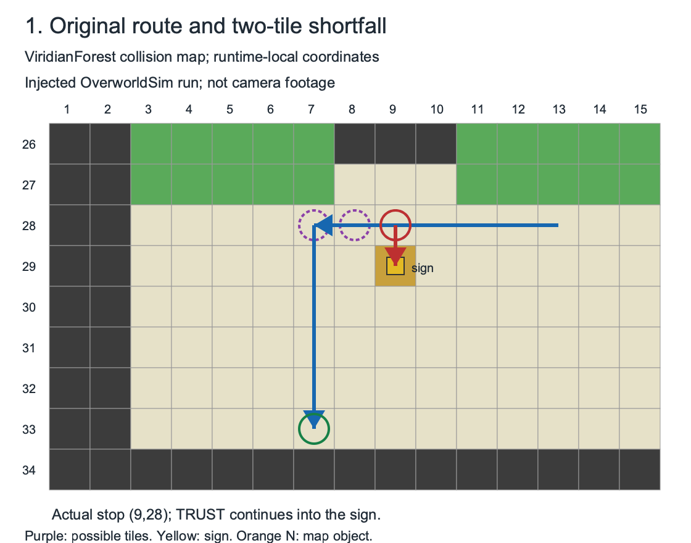
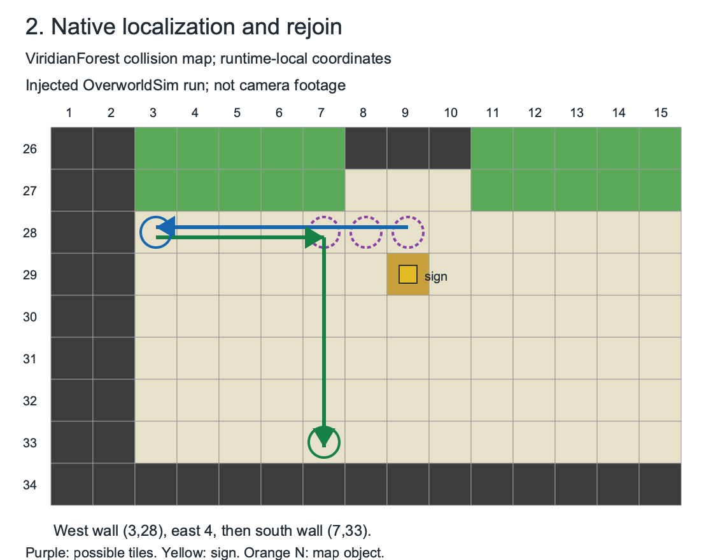

# FRLG Forest: native recovery review

[Readable replay data](frlg-forest.trace) · [Full diagnostic JSON](diagnostics/frlg-forest.raw.json)

**Preconditions:** ViridianForest `(13,28)` west, ground elevation 3, no flags/variables. Walk west 6 to `(7,28)`, then south 5 to the wall at `(7,33)`. One or two steps silently fail; these are injected shortfalls, not detected battles.

| Original route / TRUST negative control | REANCHOR: actual native repair |
|---|---|
|  |  |

[Intended SVG](frlg-forest-intended.svg) · [Recovery SVG](frlg-forest-recovery.svg)

The blue route in the first panel is the original plan. The red attempted south move shows the two-tile TRUST control; it stops at the sign. The second panel draws the native-inserted repair from the same physical shortfall, then the rejoin.

| Case | Added repair | Physical final tile | Result |
|---|---|---|---|
| forest-one-short | yes | `(7, 33)` | arrived |
| forest-two-short | yes | `(7, 33)` | arrived |
| next-wall-one-short | no | `(3, 28)` | arrived |
| next-wall-two-short | no | `(3, 28)` | arrived |
| trust-one-short-control | no | `(8, 33)` | mislocalized-control |
| trust-two-short-control | no | `(9, 28)` | stopped-control |

The `next-wall` cases are synthetic extensions on the same real board: change the second leg to west 4 toward `(3,28)`. That hold already converges from all three possible tiles, so native inserts no repair. The TRUST cases intentionally disable recovery: one silently claims completion at `(7,33)` while physically at `(8,33)`; two reads the sign twice and fails.

**Evidence:** the original Forest geometry and silent-shortfall/sign failure are reproduced from native `test_short_leg_then_sign` / `test_short_leg_unseen` (r16 Console B, 2026-11-01) in `PokemonFRLG_OverworldSim_Tests.cpp`. The new exporter invokes production `run_route()` with `OverworldSimWalker`; its `calls` capture actual planner-selected legs and physical simulated poses. Python checks these legs on identical pinned map bytes. No terrain or native recovery logic changed.

**Limits:** `(7..9,28)` is reconstructed from the logged two-tile policy; native internal candidate storage is not exported. Wall checks are explicitly SKIP in this geometry test. Camera detectors, queue draining, stillness/timing, unknown encounter origins and larger shortfalls are unverified. Native recovery is a bounded heuristic (including next-wall and repair-cost checks), not a universal recovery guarantee. Python now rejects a vertical sign interaction as a wall anchor.

Each `calls` line separates the planned endpoint from physical before/after poses and the facing supplied to the walker. `native` preserves plan, recovery and completion claims. The raw diagnostic checksum and every replay fact are checked when loading the readable data. The diagrams complement these facts; they do not carry timing or provenance.

Native source revision: `2b29dbc6e5ee2499f22ec60ee5fff2a3d0ecc356`. This exporter remains locally committed pending native publication approval; native CI has not run.

```sh
PYTHONPATH=src python3 -m pokesim.maps.frlg_native_recovery_replay check
PYTHONPATH=src python3 -m pokesim.maps.frlg_native_recovery_review --out data/navigation/native-recovery --png
```
