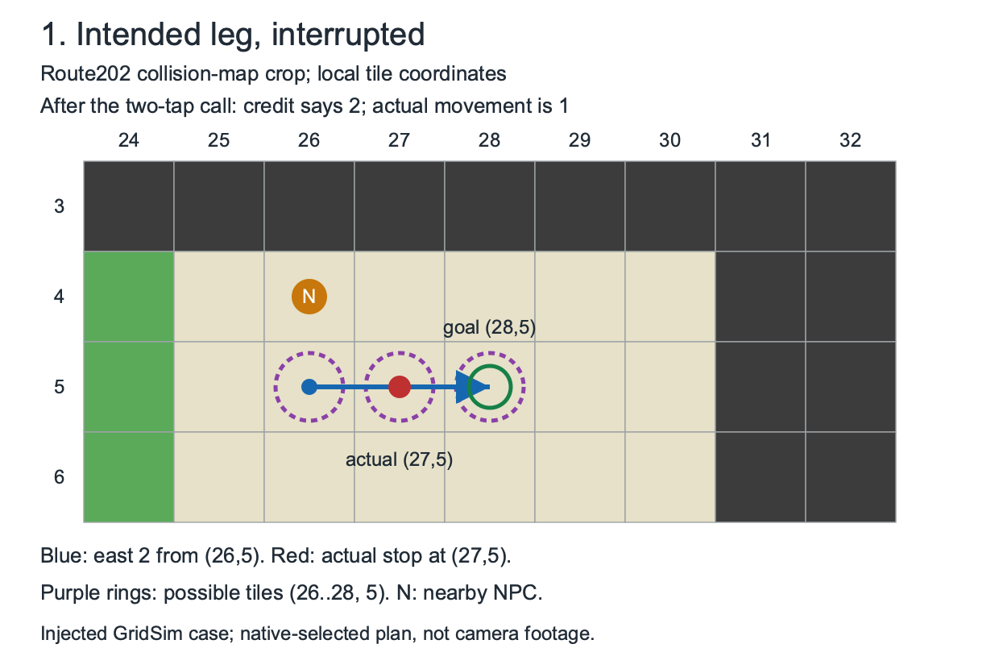
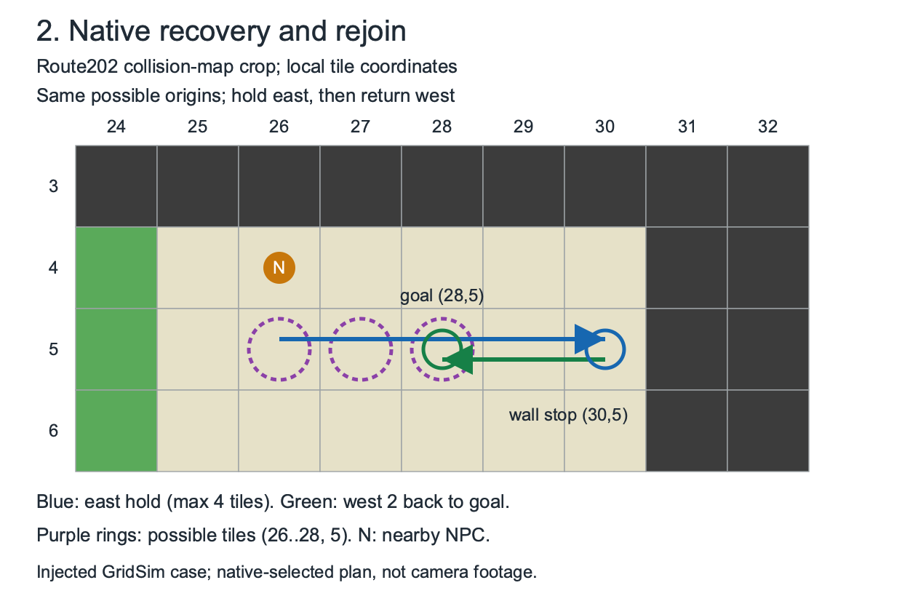

# BDSP Route 202 recovery: review summary

Replay data: [bdsp-route202.trace](bdsp-route202.trace) — shared context and one action per line. The [complete raw JSON](diagnostics/bdsp-route202.raw.json) is a separate diagnostic artifact.

**Preconditions:** Route202, start `(26,5)` east, goal `(28,5)` west; scene state 1, Running Shoes available, RUN policy. All encounters below are injected and already cleared.

| Intended leg and interruption | Native recovery and rejoin |
|---|---|
|  |  |

[Intended-route SVG](bdsp-route202-intended.svg) · [Recovery SVG](bdsp-route202-recovery.svg)

Map backgrounds: dark walls, tan floor, green grass. Orange N marks the nearby NPC. Both panels use the same coordinates.

**Key example:** two east taps receive two credited chunks, but an encounter before the last step leaves the simulated player at `(27,5)`, only one tile from the start. Native keeps `(26,5)`, `(27,5)` and `(28,5)` possible, holds east to `(30,5)`, then returns west to the original goal `(28,5)`.

## Seven cases

“After tap call” and facing are simulator truth. The native API returns positions without facing evidence. All tap calls below credit two chunks. Known-origin cases retain all three possible tiles; unknown-origin cases stop without localizing from this leg.

| Case | After tap call (sim) | Wall attempts | Outcome |
|---|---|---:|---|
| last tap before | `(27,5)` | 1 | Arrived; sim `(28,5)` west |
| last tap after | `(28,5)` | 1 | Arrived; sim `(28,5)` west |
| interrupted wall retry | `(27,5)` | 2 | Arrived; sim `(28,5)` west |
| last wall retry succeeds | `(27,5)` | 4 | Arrived; sim `(28,5)` west |
| interrupted wall budget | `(27,5)` | 4 | Stop: recovery budget exhausted |
| first tap unknown origin | `(27,5)` | 0 | Stop: unknown encounter origin |
| reported unknown origin | `(27,5)` | 0 | Stop: unknown encounter origin |

**Retry policy:** BDSP allows an initial wall attempt plus three retries: four total. The fourth can succeed after three interruptions; four interruptions fail. Python `Session` separately defaults to three recovery calls total; these budgets are not equivalent.

## How to read the trace

| Fields | Evidence retained |
|---|---|
| `[context]`, `encounter` | Shared map/elevation/start/goal/policy, then the injected encounter phase/origin for each case. |
| `calls` | Requested turns/taps/holds; stop reason, elapsed time, battles and credited chunks; physical before/after poses. |
| `native` | Actual native plans, replan candidates, completion basis and arrival/failure facts. `>` marks a plan leg. |
| `declared`, `physical` | Positions returned by the native API versus simulated truth. A `?` facing is explicitly unreported; `none` means no positions were returned. |
| `failure` | Exact failure reason, or an empty string on success. |
| `[source]` | Full revisions, map/exporter hashes and the raw-diagnostic checksum. |

The pictures show the spatial sequence; the table covers the cases and outcomes. They do **not** replace raw reports, timings or provenance. Native facing belief, queue draining, advancing video confirmation, detector timing and a global retry budget remain unverified.

## Regenerate

```sh
PYTHONPATH=src python3 -m pokesim.maps.bdsp_native_recovery_review \
  --out data/navigation/native-recovery --png
```

SVG/Markdown need only the standard library; PNG rendering additionally uses CairoSVG.

Native revision: `0bd414eabe477beb2be044cfe5057c5bec548db6`. Map revision: `7364f4b35f125622a1ca49c63248cd20195ffafd`.
