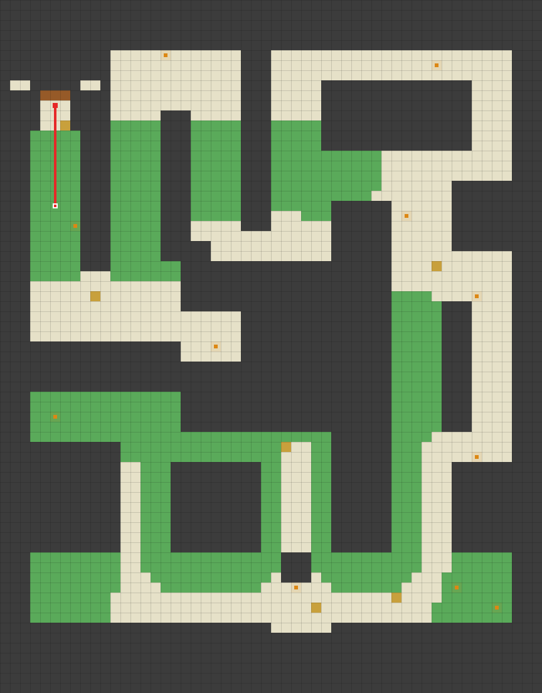
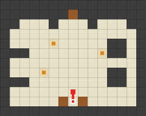
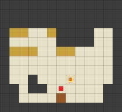
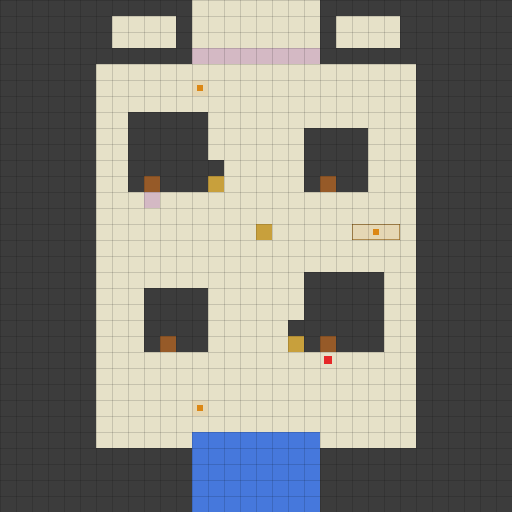
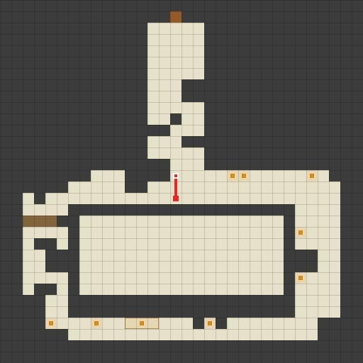

# Annotated transition scenarios

These collision diagrams show actual source-grounded checkpoint slices and
one explicitly labeled diagnostic of the new mine interruption report. They
are **Python candidates, not native planner replays**. Coordinates are local
to each named map; there is no implied alignment between panels.

Maps: unchanged publishing commit
`86cbad9144970e546a2fa4ee5d49cfea7905de3c`. Context, source revision,
checkpoint/step, injected observations and trace assertions live in
[transition-cases.json](../../../src/pokesim/maps/scenarios/transition-cases.json).
See [the inventory](../TRANSITION_SCENARIOS.md) for preconditions and gaps.

Regenerate explicitly with the examples in the inventory, using this directory
as `--draw-dir`. Tests never rewrite these documentation assets. Orange marks
NPCs/possible occupancy, purple marks active or unknown scenes, red marks the
local route. SVGs carry axes and labels; PNGs provide raster previews.

## FRLG forest north gate — native test start and goal

Source: #216 `test_forest_north_gate`, cp0007 m6f/r15. The first panel ends
before the cave warp; the next north input reaches gate `(7,10)`, facing north.
The second panel shows the last north step off that arrival mat to `(7,9)`.
Fade/battle confusion is injected in the semantic replay, not drawn as a path.

[Annotated forest approach](forest-north-gate-1.svg)

[Annotated gate arrival](forest-north-gate-2.svg)

## BDSP house — declared native arrival

Source: #226 `00.01 / out_of_the_house`, also r27's `00.03` exit.
Both door scenes are explicitly assumed spent. There is no red walking leg
across the two panels: south onto `(6,10)` is a transition to `(20,22)` south,
provided as a reviewed adapter contract. Reverse entrance remains a gap.

[Annotated house exit](bdsp-player-house-exit-1.svg)

[Annotated Twinleaf arrival](bdsp-player-house-exit-2.svg)

## BDSP mine — interruption diagnostic on unchanged terrain

The user's November 5 report describes row 15 instead of intended row 17.
This diagnostic retains `(15,15)`, `(15,16)` and `(15,17)` before moving east.
All three can clip south against row 18 to reach `(15,17)`. An interrupted clip
is not complete: escape, observe the overworld, drain inputs, then repeat within
the retry budget. This diagram draws one possible starting row; it is not a
claim that the report proves that exact pre-battle pose or counter root cause.

[Annotated mine south clip](mine-south-clip-after-battle-1.svg)

