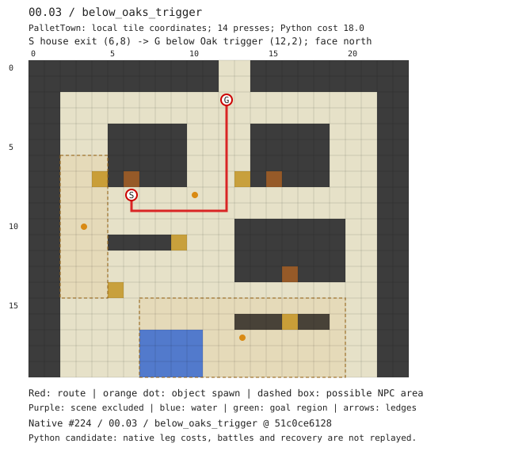
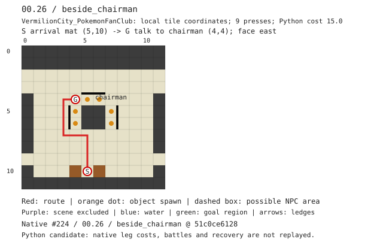
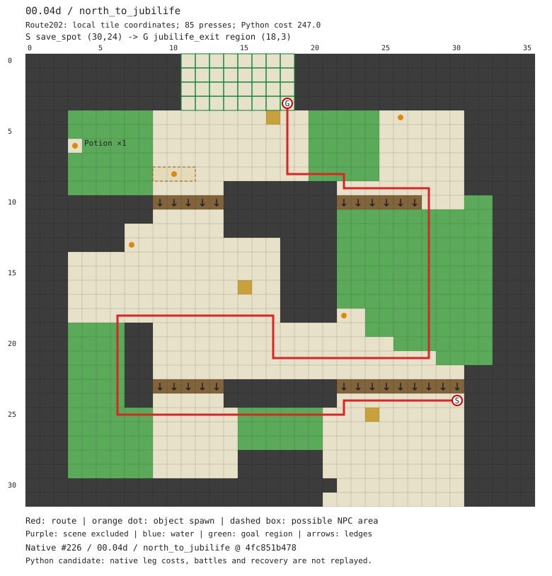

# AutoStory route references and goldens

These are Python candidates for reviewed AutoStory **local route contracts**.
They do not replay the native C++ planner or a full checkpoint. Inputs in
[cases.json](cases.json) record the native PR, exact commit, source file,
checkpoint, step and any derived/assumed state. The three map JSON inputs were
checked byte-for-byte against those native snapshots and match.

| Reference | Native local contract | Python candidate |
|---|---|---|
| FRLG #224, `00.03 / below_oaks_trigger` | House exit `(6,8)` to `(12,2)`, facing north, short of Oak's trigger. | 14 presses / cost 18 |
| FRLG #224, `00.26 / beside_chairman` | Fan Club arrival mat `(5,10)` to `(4,4)`, facing east toward chairman `(5,4)`. Entry pose is derived from the destination warp, not the start of the full cross-map route. | 9 presses / cost 15 |
| BDSP #226, `00.04d / north_to_jubilife` | `save_spot (30,24)` to any tile in `jubilife_exit`, after the catch tutorial. | 85 presses / cost 247; ends at `(18,3)` |

Python costs are not native planner costs. Native FRLG includes grass and open
leg-stop penalties; BDSP uses robust leg planning and battle-aware recovery.
The Python candidate still excludes cross-map movement, trainer sight, battles
and recovery. `VAR_ROUTE_202_STATE=1` represents a disarmed tutorial here:
the story ordering establishes that it has finished, but the numeric value is
an explicit modeling assumption, not extracted from the native row.

The former lab-front / above-chairman routes and unknown-tutorial detour were
handpicked diagnostics, not AutoStory references. They have been replaced;
unknown-state behavior remains covered by unit tests.

## Annotated views

SVG is the primary review view: map name, axes, exact endpoints, required
facing, source checkpoint and legend are included. PNG remains the raster
regression fixture. Orange dots are object spawn positions; dashed/tinted
areas are conservative NPC occupancy, not water. Purple is an excluded scene;
green outlines the goal region; arrows are one-way ledges.

### FRLG: walk short of Oak's trigger



[Route JSON](frlg-pallet-town.json) · [PNG](frlg-pallet-town.png)

### FRLG: talk to the Fan Club chairman from the west



[Route JSON](frlg-fan-club.json) · [PNG](frlg-fan-club.png)

### BDSP: saved position to the Jubilife exit region



[Route JSON](bdsp-route202-story.json) · [PNG](bdsp-route202-story.png)

## Check and review updates

```sh
PYTHONPATH=src python3 -m pokesim.maps.test_route_goldens
PYTHONPATH=src python3 -m pokesim.maps.test_route_goldens --update
```

Normal discovery never rewrites snapshots. Tests compare exact route JSON,
decoded PNG pixels and annotated SVG text. Mismatches save actual output to
`build/route-goldens/`, uploaded by CI on failure. Review the source contract,
state and visual differences before regenerating; a snapshot refresh alone
does not establish native parity or correctness in the game.
