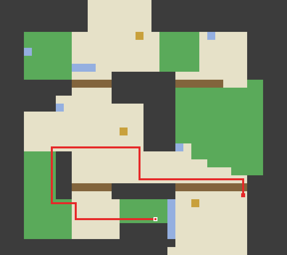
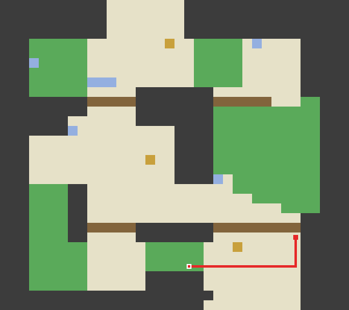

# Runtime route goldens

These fixtures exercise the checked-in runtime JSON maps without Git history,
network access or external decomp checkouts. Each case has a route JSON snapshot
and a lossless PNG preview. They record the current static planning policy;
they are not console validation or proof of a complete story plan.

| Case | Presses / cost | Route and preview |
|---|---:|---|
| Pallet Town: house front to Oak's lab | 16 / 22 | [JSON](frlg-pallet-town.json), [PNG](frlg-pallet-town.png) |
| Vermilion Fan Club: around NPCs and closed sides | 10 / 14 | [JSON](frlg-fan-club.json), [PNG](frlg-fan-club.png) |
| Route202: tutorial variable unknown | 51 / 131 | [JSON](bdsp-route202-unknown-scene.json), [PNG](bdsp-route202-unknown-scene.png) |
| Route202: tutorial disarmed | 14 / 21 | [JSON](bdsp-route202-after-tutorial.json), [PNG](bdsp-route202-after-tutorial.png) |

Inputs and the reason for each case are in [cases.json](cases.json). Snapshots
record the map byte hash, coordinate frame, state, exact moves/elevations and
cost. Image comparisons use decoded dimensions and RGBA pixels, so a harmless
change in PNG compression does not fail the test.

Red is the computed route, blue is excluded object/scene area, and black lines
on open tiles are closed sides. These are collision-map drawings, not game art.

| Route202: unknown scene state | Route202: known disarmed scene |
|---|---|
|  |  |

## Check and review updates

From the repo root:

```sh
PYTHONPATH=src python3 -m pokesim.maps.test_route_goldens
PYTHONPATH=src python3 -m pokesim.maps.test_route_goldens --update
```

Normal test discovery never regenerates snapshots. A mismatch writes actual
JSON and PNG to `build/route-goldens/`; CI uploads that directory on failure.
Review the actual/expected route and image, explain the underlying map or policy
change, and only then run `--update`. Commit the reviewed JSON/PNG changes
together. Refreshing snapshots merely to make a failure disappear is not a fix.
